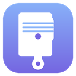

<h1 align="center">Piston</h1>

Editor de PDF para Windows

Aquí se publican los instaladores de Piston. El programa consulta este repositorio al arrancar y avisa cuando hay una versión nueva.

## Descargar

Descarga la última versión en **[Releases](../../releases/latest)** (`Piston-X.Y-setup.exe`).

El instalador no pide permisos de administrador. Opcionalmente añade un icono en el escritorio y la opción «Abrir con → Piston» en los archivos PDF.

## Qué hace

- Cambia palabras, líneas o párrafos de un PDF conservando la fuente, el tamaño y el color originales.
- Borra texto sin dejar huecos: los fondos, las imágenes y las tablas se conservan.
- Añade texto, imágenes o firmas.
- Reordena, gira, duplica y elimina páginas; une PDFs.
- Busca y reemplaza en todo el documento.
